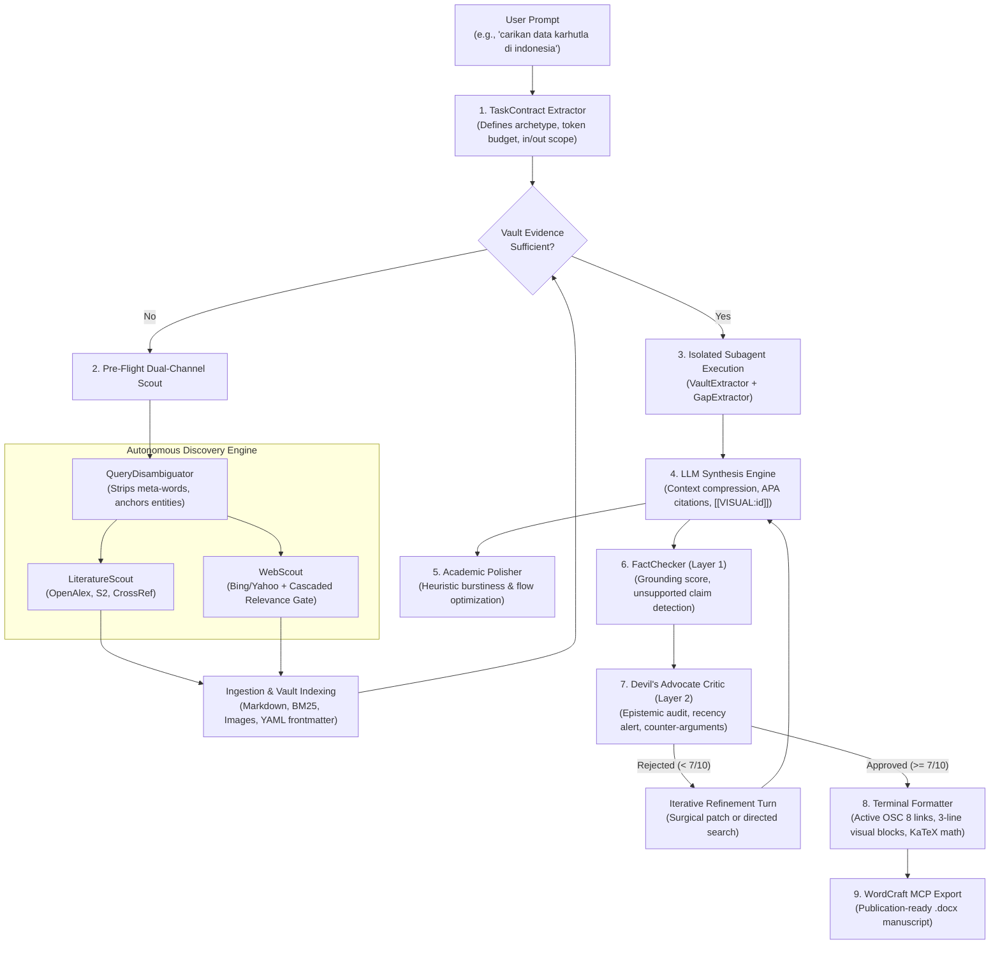

# scrpcy

[](https://www.python.org/downloads/)
[](https://opensource.org/licenses/MIT)
[](#introduction)
[](#architecture--workflow)

A local-first, autonomous academic research studio that bridges scholarly literature repositories, sovereign institutional portals, and multi-model AI synthesis into publication-grade manuscripts with verifiable epistemic rigor.

---

## Table of Contents
- [Introduction](#introduction)
- [Architecture & Workflow](#architecture--workflow)
- [Key Capabilities](#key-capabilities)
- [Installation](#installation)
- [Configuration & BYOK Models](#configuration--byok-models)
- [CLI & Studio Navigation](#cli--studio-navigation)
- [Python API Usage](#python-api-usage)
- [References & Acknowledgements](#references--acknowledgements)
- [Testing](#testing)

---

## Introduction

Modern Large Language Models (LLMs) often struggle with scholarly research: they hallucinate citations, generate superficial prose ("AI slop"), become overwhelmed by generic token matching (such as treating the word *"data"* as the query topic instead of the substantive entity), and prioritize high-level institutional homepages over empirical data.

**Scrpcy** is engineered from the ground up to eliminate these vulnerabilities. Operating on a **local-first paradigm**, Scrpcy stores all document vaults, caches, vector embeddings, chat sessions, and SQLite state machines directly inside isolated project directories on your machine (`projects/<name>/`).

### Core Design Principles
1. **Zero Hallucination Tolerance**: Every claim must be supported by local vault documents. If evidence is missing, the system explicitly declares the data gap rather than fabricating statistics.
2. **Pre-Flight Dual-Channel Scouting**: Searches global scholarly literature (OpenAlex, Semantic Scholar, CrossRef, Unpaywall) alongside sovereign government and institutional portals (`.go.id`, `.gov`, `.who.int`) right from the start.
3. **Query Disambiguation & Lexical Anchor Gating**: Conversational filler and generic meta-tokens (`data`, `laporan`, `terbaru`, `definisi`) are stripped before querying search engines, while hard relevance gates reject irrelevant homepages.
4. **Dual-Layer Epistemic Verification**:
   - *Layer 1 (Contract Conformance)*: Enforces strict word count budgets, scope boundaries, and format specifications.
   - *Layer 2 (Epistemic Rigor & Devil's Advocate)*: Audits empirical grounding, flags outdated baselines, and forces iterative counter-argument refinement.
5. **Interactive Terminal Visuals**: Extracts figures, charts, and infographics into dedicated 3-line visual blocks equipped with active OSC 8 clickable terminal hyperlinks (`file:///`) and automated APA in-text citations.
6. **Publication Compilation**: Exports verified research reviews directly into Microsoft Word (`.docx`) with styled headings and citation bibliographies via the Model Context Protocol (MCP) or native fallbacks.

---

## Architecture & Workflow



---

## Key Capabilities

### 1. Pre-Flight Dual-Channel Scouting
Rather than treating official websites as a reactive fallback, Scrpcy initiates two discovery pipelines in parallel:
- **Literature Scout**: Explores 250M+ scholarly works across OpenAlex and Semantic Scholar, resolving open-access PDFs, abstracts, and citation counts.
- **Web Scout**: Queries Bing, Yahoo, and DuckDuckGo for sovereign government domains (`.go.id`, `.gov`, `.gov.uk`, `.mil`), accredited research institutes (`.ac.id`, `.edu`), and intergovernmental organizations (`who.int`, `worldbank.org`, `ipcc.ch`).

### 2. Query Disambiguation & Entity Anchoring
Inspired by Stanford STORM and GPT-Researcher, the `QueryDisambiguator`:
- Strips conversational preambles (`"carikan aku"`, `"tolong jelaskan"`) and generic meta-tokens (`"data"`, `"informasi"`, `"terbaru"`, `"laporan"`).
- Isolates substantive topic entities (`"karhutla"`, `"stunting"`, `"inflasi"`) and injects empirical metrics (`"luas"`, `"hektar"`, `"hotspot"`, `"prevalensi"`).
- Automatically anchors known strategic domains to specialized ministerial subdomains (e.g. mapping *karhutla* to `sipongi.menlhk.go.id` and `menlhk.go.id`).

### 3. Cascaded Waterfall Relevance Filtering
Inspired by FlashRAG and MindSearch, WebScout prevents domain authority from overriding topical relevance:
- **Lexical Anchor Gate**: If candidate titles, snippets, and URL paths do not contain the core topic entity, the relevance score drops to `0.0` and the page is rejected immediately, even if it carries a perfect 1.0 sovereign authority score.
- **Root Landing Page Rejector**: Automatically drops generic homepages (e.g., `https://www.bps.go.id/id`, `https://data.go.id/`) that lack deep topical article paths.
- **Waterfall Score**: Computes $\text{FinalScore} = \text{Relevance} \times (1 + 0.5 \times \text{Authority})$ for all candidates passing the threshold.

### 4. Structured 3-Line Visual Blocks with Clickable Links
When raster plots, charts, or maps are indexed from papers or web pages, Scrpcy renders them in a readable 3-line block:
```markdown
[📊 Buka Gambar](file:///C:/path/to/project/vault/images/fig_1.png)  
Figure 3. Annual Hotspot Distribution Across Peatland Formations  
(Nurhayati et al., 2021)
```
- Line 1 emits active OSC 8 terminal hyperlinks, opening the image in your OS default viewer with Ctrl+Click.
- Line 2 provides the descriptive caption.
- Line 3 provides the formal APA citation of the originating source document.

### 5. Clean Master Project Isolation
All projects reside cleanly inside dedicated directories:
```
projects/
└── karhutla_study/
    ├── .scrpcy/          # Project metadata & token consumption logs
    ├── cache/            # Markdown representations with YAML frontmatter
    ├── drafts/           # Exported manuscripts and working drafts
    ├── logs/             # studio.log & events.jsonl audit trails
    ├── vault/            # PDF papers, HTML web archives, extracted figures
    ├── chats.db          # Multi-session conversational SQLite database
    └── tasks.db          # Background concurrent task execution database
```

---

## Installation

### Prerequisites
- **Python**: Version 3.11 or higher.
- **Git**: Installed and available on your system `PATH`.
- **Operating System**: Windows, macOS, or Linux.

### 1. Clone the Repository
```bash
git clone https://github.com/your-username/scrpcy.git
cd scrpcy
```

### 2. Create and Activate a Virtual Environment
```bash
# On Linux / macOS:
python3 -m venv .venv
source .venv/bin/activate

# On Windows (PowerShell):
python -m venv .venv
.\.venv\Scripts\Activate.ps1
```

### 3. Install Scrpcy in Editable Mode
```bash
pip install -e ".[dev]"
```

Verify your installation:
```bash
scrpcy --help
```

---

## Configuration & BYOK Models

Scrpcy utilizes a Bring-Your-Own-Key (BYOK) architecture. Your API keys are saved locally in `~/.scrpcy/config.json` and are never shared or sent to external telemetry servers.

### 1. Store API Keys
```bash
# Google Gemini (Recommended default: Gemini 2.5 Pro / Flash)
scrpcy models set-key gemini YOUR_GEMINI_API_KEY

# OpenAI (GPT-4o, o3-mini)
scrpcy models set-key openai YOUR_OPENAI_API_KEY

# Anthropic (Claude 3.5 Sonnet)
scrpcy models set-key anthropic YOUR_ANTHROPIC_API_KEY

# DeepSeek (DeepSeek-V3, DeepSeek-R1)
scrpcy models set-key deepseek YOUR_DEEPSEEK_API_KEY
```

### 2. Local 9Router or OpenAI-Compatible Gateway
If you run [9Router](https://github.com/mfthn/9router) or a local OpenAI-compatible gateway (e.g., vLLM, Ollama, LM Studio):
```bash
# Automatic 1-step 9Router connection
scrpcy models 9router

# Or specify custom host, port, and default model:
scrpcy models 9router --port 20128 --model 9router/ag/gemini-3.8-flash-medium
```

### 3. Switch Active Default Model
```bash
scrpcy models use gemini/gemini-2.5-pro
# or
scrpcy models use 9router/ag/gemini-3.8-flash-medium
```

---

## CLI & Studio Navigation

### Launching the Studio
```bash
# Launch interactive Antigravity CLI Studio
scrpcy

# Launch Web Studio server on custom port
scrpcy start --port 8080
```

### Contextual Sub-Mode Navigation

Inside the Scrpcy terminal studio, seamless slash commands allow switching context between projects, document repositories, and task queues:

| Command | Mode / Context | Description |
| :--- | :--- | :--- |
| `/projects` or `/p` | Global Dashboard | View and switch between master projects in `projects/` |
| `/vault` or `/v` | Project Context | Enter file library and manage indexed documents |
| `/processing` or `/proc` | Project Context | Monitor background asynchronous downloads and scout tasks |
| `/chat` or `/c` | Project Context | Enter research conversation hub and manage SQLite sessions |
| `/scout <query>` | Project / Chat | Trigger autonomous dual-channel literature and web scouting |
| `/findpaper <topic>` | Project / Chat | Fast search for scholarly papers via OpenAlex |
| `/gdrive <url>` | Project / Vault | Ingest documents directly from Google Drive share links |
| `/docx [filename]` | Project / Chat | Compile structured research draft to Microsoft Word `.docx` |
| `/turns <num>` | Project / Chat | Configure maximum refinement turns for FactChecker & Critic |
| `/status` | Project / Chat | Inspect active model, reasoning effort, and project token burn |
| `/back` | Sub-Mode / Chat | Return to the parent context level |
| `?` | All Modes | Display interactive contextual help |

---

## Python API Usage

### 1. Document Ingestion & Parsing
```python
from scrpcy import DocumentParser

parser = DocumentParser()
result = parser.parse("path/to/paper.pdf")

print("Title:", result.metadata.title)
print("Authors:", result.metadata.authors)
print("Cite Key:", result.metadata.cite_key)
print("Cached Markdown Path:", result.cache_path)
```

### 2. Streaming Evidence-Grounded Synthesis
```python
import asyncio
from scrpcy import LLMEngine

async def main():
    engine = LLMEngine()
    async for chunk in engine.stream_query(
        query="Bagaimana efektivitas parameter-efficient fine-tuning LoRA?",
        documents=["path/to/cached_lora.md"],
        skill_name="academic_writer",
    ):
        print(chunk, end="", flush=True)

asyncio.run(main())
```

### 3. Dual-Channel Web & Literature Scouting
```python
import asyncio
from scrpcy.core.web_scout import WebScout
from scrpcy.core.scout import LiteratureScout, ScoutQuery

async def main():
    # 1. Sovereign Web Scout
    web_scout = WebScout()
    official_hits = await web_scout.search_official_web(
        query="data terbaru karhutla di indonesia",
        limit=3,
        require_official=True,
    )
    for hit in official_hits:
        print(f"[Web] {hit.title} ({hit.domain}) -> Score: {hit.final_score:.2f}")

    # 2. Academic Literature Scout
    lit_scout = LiteratureScout()
    query = ScoutQuery(keywords="peatland fire weather", year_start=2021)
    papers = await lit_scout.search_multi_source(query, limit=10)
    for paper in papers[:3]:
        print(f"[Paper] {paper.title} ({paper.year}) - PDF: {paper.has_pdf}")

asyncio.run(main())
```

---

## References & Acknowledgements

The architecture of Scrpcy has been deeply informed and inspired by foundational research in autonomous multi-agent systems, information retrieval, and academic synthesis:

| Project / Reference | Origin / Organization | Architectural Influence on Scrpcy |
| :--- | :--- | :--- |
| **[Stanford STORM](https://github.com/stanford-oval/storm)** | Stanford OVAL | **Perspective-Guided Querying & Meta-Word Stripping**: Informed Scrpcy's `QueryDisambiguator`, removing conversational tokens and meta-words (`data`, `overview`) in favor of empirical metric expansion and two-phase portal discovery. |
| **[GPT-Researcher](https://github.com/assafelovic/gpt-researcher)** | Assaf Elovic | **Sub-Query Decomposition & Negative Filtering**: Informed Scrpcy's query reformulation, decomposing complex user questions into targeted sub-queries with negative exclusion operators (`-pengertian -definisi`). |
| **[FlashRAG](https://github.com/RUC-NLPIR/FlashRAG)** | RUC AI Box | **Cascaded Waterfall Relevance Gating**: Provided the mathematical foundation for Scrpcy's gated search scoring, ensuring domain authority cannot override low-relevance results ($\text{FinalScore} = \text{Relevance} \times [1 + 0.5 \times \text{Authority}]$). |
| **[MindSearch](https://github.com/InternLM/MindSearch)** | InternLM | **Lexical Anchor Pre-Fetch Check & Root Landing Page Rejection**: Inspired Scrpcy's pre-fetch gate verifying core entity occurrences in snippets before scraping, and the automatic rejection of shallow root homepages (`bps.go.id/id`). |
| **[Perplexica](https://github.com/ItzCrazyK/Perplexica)** | ItzCrazyK | **Boolean Search Restructuring**: Informed Scrpcy's search operator formulation and multi-engine fallback strategies across Bing, Yahoo, and DuckDuckGo. |
| **[PaperQA / PaperQA2](https://github.com/Future-House/paper-qa)** | FutureHouse | **Evidence Synthesis & Fact-Grounding**: Informed Scrpcy's chunk-level evidence ranking, BM25 retrieval, and citation mapping to prevent LLM hallucinations. |
| **[Microsoft AutoGen](https://github.com/microsoft/autogen)** | Microsoft Research | **Multi-Agent Conversational Choreography**: Guided the isolated subagent architecture separating `Contractor`, `VaultExtractor`, `GapExtractor`, `FactChecker`, and `DevilsAdvocate`. |
| **[Google Antigravity](https://deepmind.google/)** | Google DeepMind | **Terminal Studio Craft & UX Principles**: Informed Scrpcy's duotone minimalist palette, outlier input framing, background task telemetry, and structured artifact generation. |
| **[PyMuPDF4LLM](https://github.com/pymupdf/pymupdf4llm)** | Artifex Software | **High-Fidelity Document Ingestion**: Powers Scrpcy's local PDF parsing, converting academic tables and layout columns into clean Markdown. |
| **[Model Context Protocol (MCP)](https://modelcontextprotocol.io/)** | Anthropic | **Extensible Tool Interoperability**: Utilized in Scrpcy's `WordCraftClient` for dispatching manuscript authoring commands to WordCraft. |

---

## Testing

Scrpcy includes an extensive test suite covering unit heuristics, multi-source federation, subagent contracts, and end-to-end headless verification:

```bash
# Run the entire test suite
pytest -q

# Run WebScout and query disambiguation tests
pytest -q tests/test_web_scout_sorting.py tests/test_web_scout.py

# Run agent loop and task contract tests
pytest -q tests/test_agentic_tool_loop.py tests/test_project_submodes.py
```

---

## License

Scrpcy is distributed under the [MIT License](LICENSE).
